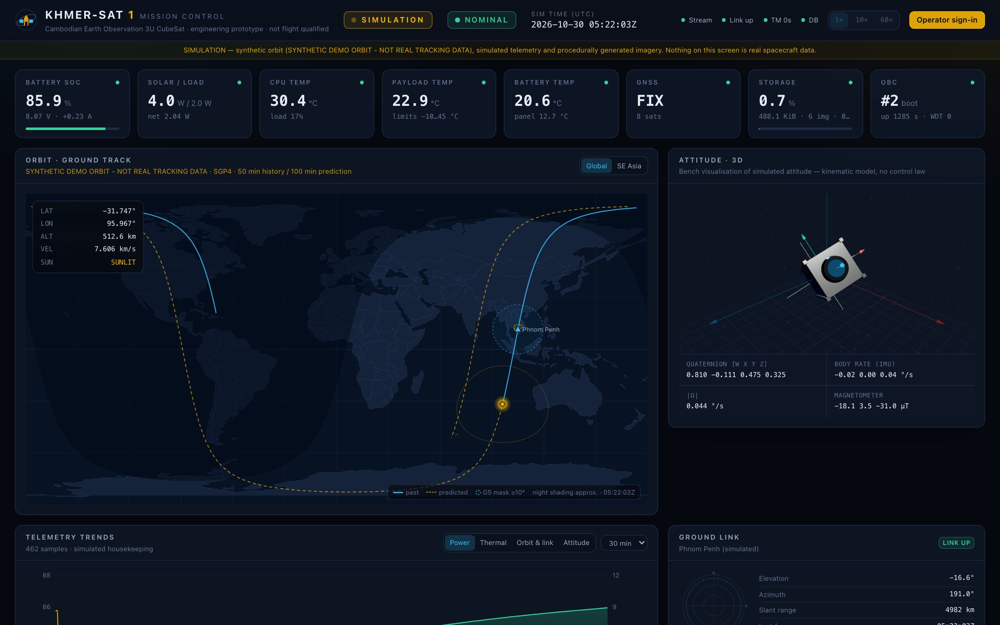
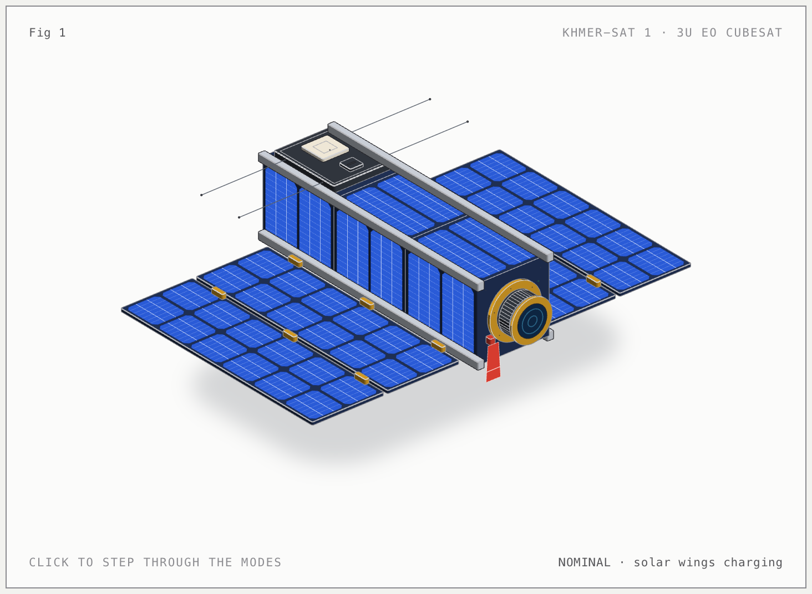
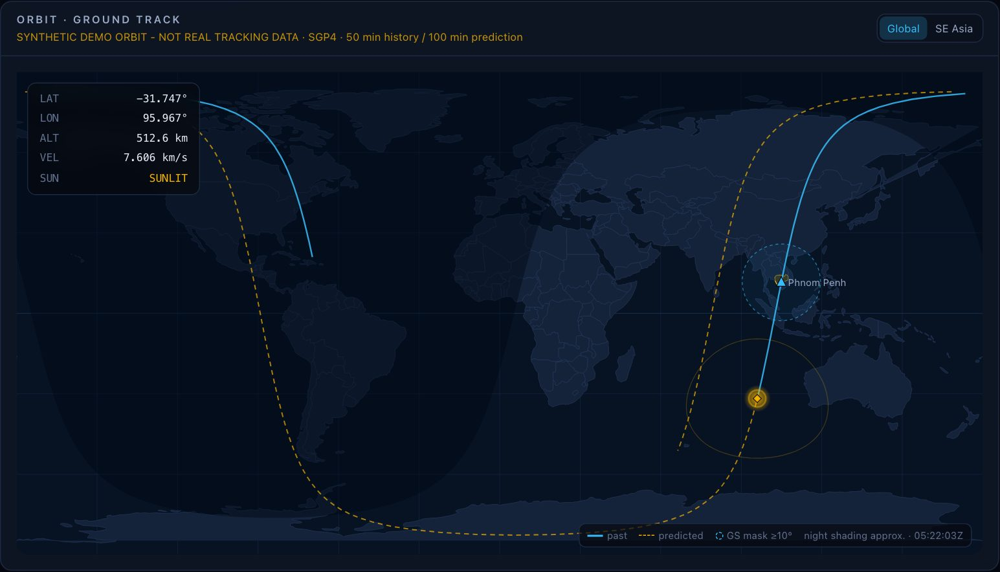
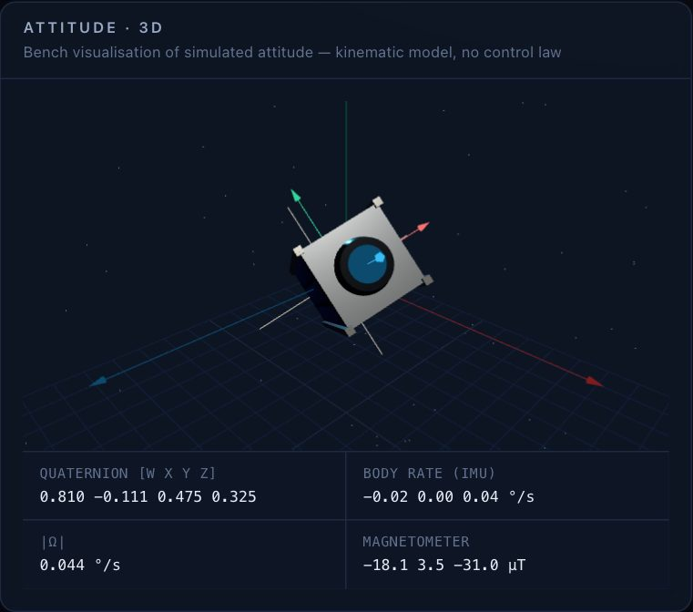
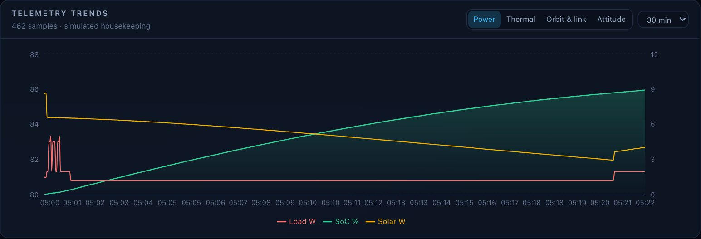
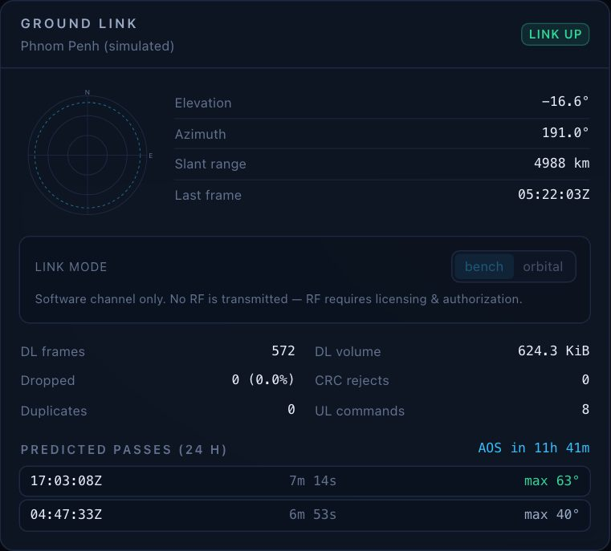
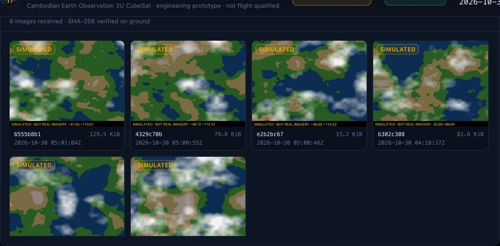
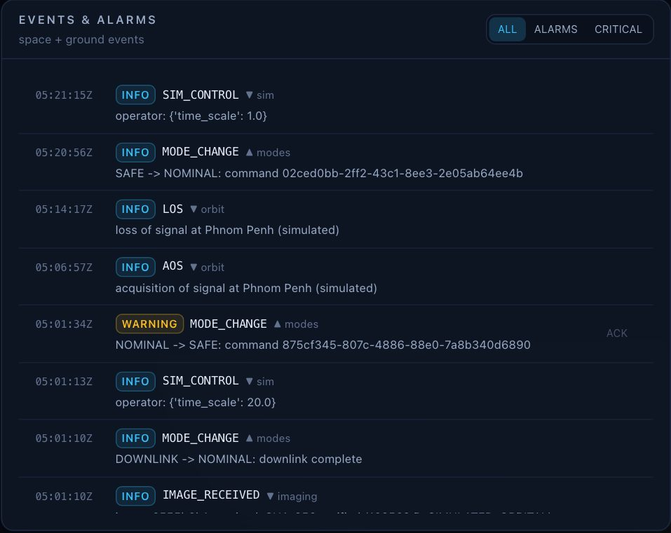
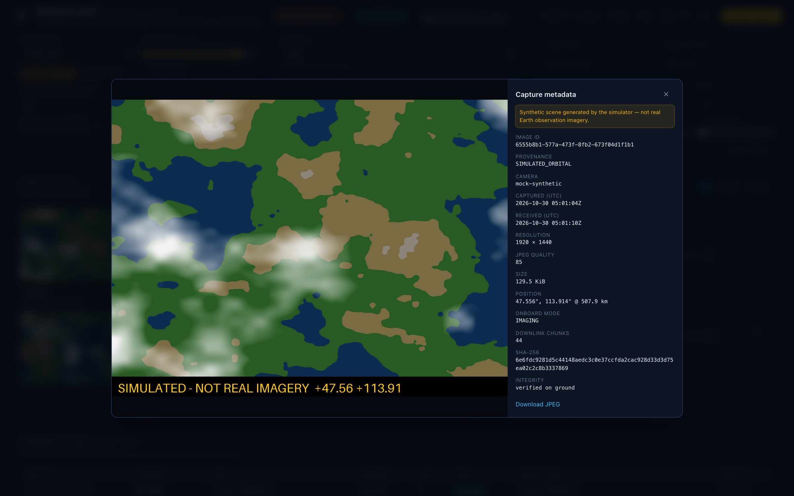
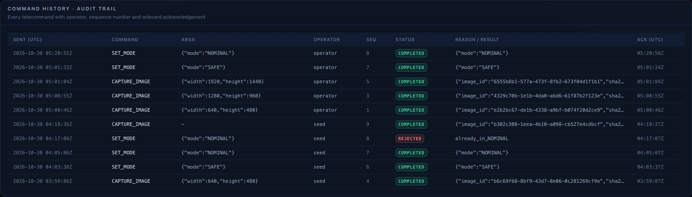

# KHMER-SAT 1

**Cambodian Earth Observation 3U CubeSat — software-first engineering prototype**

Flight software, spacecraft simulator, ground segment, and a web mission control
for a 3U Earth-observation CubeSat. It is built so it can later connect to real
sensors, a camera, power hardware, and an *authorized* ground link.



<p align="center"><sub>Mission control in SIMULATION mode: live housekeeping, SGP4 ground track with the Phnom Penh visibility mask, and the 3D attitude view. All data shown is simulated.</sub></p>

> [!IMPORTANT]
> **This is not flight software and nothing here is flight qualified.**
> All orbital data comes from a **synthetic** demonstration orbit (it is not real
> tracking data). Telemetry is simulated, and the images are procedurally
> generated and stamped `SIMULATED`. Unknown hardware values are marked **TBD**.
> The code contains no RF transmission (see [docs/safety.md](docs/safety.md)).

---

## Contents

- [What's inside](#whats-inside)
- [The prototype](#the-prototype)
- [Screenshots](#screenshots)
- [Quick start (local, no Docker)](#quick-start-local-no-docker)
- [Run with Docker Compose](#run-with-docker-compose)
- [Using mission control](#using-mission-control)
- [Testing](#testing)
- [Repository layout](#repository-layout)
- [Architecture](#architecture)
- [Security model](#security-model)
- [Project status](#project-status)
- [Roadmap](#roadmap)
- [Documentation](#documentation)

## What's inside

| Area | Highlights |
|---|---|
| **Mission control** | Dark-theme React dashboard: live status, SGP4 ground track with the Phnom Penh visibility mask and pass predictions, 3D attitude (Three.js), battery and thermal tiles, telemetry trends, camera control, image gallery with metadata, telecommand console, audit trail, events/alarms with acknowledgement, fault injection, and an always-visible **SIMULATION / HARDWARE** indicator |
| **Orbit** | SGP4 (`python-sgp4`), explicit UTC, TEME → ECEF → WGS-84, topocentric look angles, AOS/LOS pass prediction, sun position and eclipse. The station location is configurable (default: Phnom Penh) |
| **Flight software** | Modes `BOOT · NOMINAL · IMAGING · DOWNLINK · SAFE · FAULT` with an explicit transition table, FDIR, an isolating task scheduler, a watchdog heartbeat, persistent state with atomic writes, and structured JSON logs |
| **Camera payload** | Mock, USB/V4L2, and Raspberry Pi camera adapters. JPEG compression, SHA-256, UTC timestamps, metadata, thumbnails, time-tagged captures, a local queue, and selective-repeat downlink. Every image records its provenance (`SIMULATED_ORBITAL` / `GROUND_TEST_HARDWARE` / `MOCK_SAMPLE`) |
| **Protocol** | Versioned binary frames with a CRC-16. Commands are signed with HMAC-SHA256 and protected against replay. A two-step ARM/EXECUTE interlock and an onboard confirmation guard safety-critical commands |
| **Power & ADCS sim** | Energy balance (attitude-dependent solar input, eclipse, battery, mode loads), quaternion attitude, mock IMU and magnetometer. The attitude model is kinematic only; no control-law capability is claimed |
| **Ground segment** | FastAPI, WebSockets, PostgreSQL/TimescaleDB (SQLite for local dev), MinIO, and an authenticated MQTT broker. The ground segment keeps running through database outages and back-fills the data afterwards |
| **Watchdog MCU** | Portable C99 watchdog/health state machine (reset, power-cycle on a reset storm, brown-out hold) with host unit tests and an RP2040 port |

## The prototype

<picture>
  <source media="(prefers-color-scheme: dark)" srcset="docs/images/prototype-figure.png">
  
</picture>

KHMER-SAT 1 as a 3U Earth-observation CubeSat:
- **Body:** the standard 3U envelope, 100 × 100 × 340.5 mm, with aluminium rails on its four long edges and solar cells on its faces.
- **Wings:** two deployed solar wings, each made of two full-length panels on gold hinges.
- **Top:** a UHF antenna module with four tape antennas, a GPS patch and a sun sensor.
- **End face:** the camera lens, and the red remove-before-flight tag that is pulled before launch.

The wing size, cell layout, antennas and optics are illustrative, because the real parts are still to be selected (see [docs/hardware-bom.md](docs/hardware-bom.md)). The modes the figure steps through (NOMINAL, IMAGING with its 5 s hold, DOWNLINK, SAFE) are the flight software's own.

The interactive version is [`docs/figure/khmer-sat-1-prototype.html`](docs/figure/khmer-sat-1-prototype.html): click it to step through the modes. GitHub can't run it, so download it and open it in a browser. Rebuild it with `node docs/figure/build.mjs` (add `--dark` for the dark theme).

## Screenshots

| Orbit · ground track | Attitude · 3D |
|---|---|
|  |  |
| **Telemetry trends** | **Ground link & pass prediction** |
|  |  |
| **Image gallery** (SHA-256 verified, provenance-tagged) | **Events & alarms** |
|  |  |

**Capture metadata.** Every image carries its provenance, UTC timestamps, position, checksum and downlink details. Synthetic scenes are stamped `SIMULATED` in the pixels themselves.



**Command history and audit trail.** Every telecommand is listed with its operator, sequence number and onboard acknowledgement.



## Quick start (local, no Docker)

Requirements: **Python 3.12+** with [uv](https://docs.astral.sh/uv/), **Node 20+**.

```bash
git clone https://github.com/khmermega/khmer-sat-1.git
cd khmer-sat-1
uv sync                                  # Python deps into .venv
uv run python scripts/init_env.py        # creates .env with random secrets
npm --prefix ground-station/frontend install
```

Start the backend (terminal 1):

```bash
uv run python -m uvicorn app.main:app --app-dir ground-station/backend --port 8000
```

Start the dashboard (terminal 2):

```bash
npm --prefix ground-station/frontend run dev
```

Open **http://localhost:5173**. To send commands, click **Operator sign-in** and
paste `OPERATOR_TOKEN` (or `ADMIN_TOKEN` for safety-critical commands) from your `.env`.

Optional: pre-fill a few hours of simulated history before starting the backend:

```bash
uv run python scripts/seed.py --hours 3
```

## Run with Docker Compose

```bash
python3 scripts/init_env.py      # once
docker compose up --build
```

| Service | URL (bound to 127.0.0.1) |
|---|---|
| Mission control | http://localhost:8080 |
| API + OpenAPI docs | http://localhost:8000/docs |
| MinIO console | http://localhost:9001 |
| PostgreSQL | localhost:5432 |
| MQTT (auth required) | localhost:1883 |

To use TimescaleDB instead of plain PostgreSQL, set `POSTGRES_IMAGE=timescale/timescaledb:latest-pg16`, then run
`scripts/timescale.sql`.

## Using mission control

- **Time acceleration:** the `1× / 10× / 60×` buttons in the header. The demo orbit
  passes over Phnom Penh about 10 minutes after start.
- **Link mode:** `bench` is an always-connected wired or simulated link. `orbital`
  only carries data while the station can see the satellite, with AOS/LOS events.
- **Camera:** pick a resolution and quality, then *Capture now* or *Schedule*. Images
  downlink automatically and are SHA-256 verified on the ground.
- **Telecommand:** routine commands are sent directly. ⚠ Critical commands
  (`REBOOT`, `CLEAR_FAULT`, `DELETE_ALL_IMAGES`) need the admin token, an **Arm**
  step, and a **Confirm** within 30 s.
- **Fault injection:** camera failure, battery drain, over-temperature, GNSS
  outage, flight-software hang (watchdog), network disconnect, storage
  exhaustion, ground DB outage, and packet loss / corruption / duplication.

Repeatable demos against a running backend:

```bash
uv run python scripts/demo_scenarios.py list
uv run python scripts/demo_scenarios.py run watchdog-recovery
```

Run the flight software alone against the simulator:

```bash
uv run python -m onboard --sim --minutes 10
```

## Testing

```bash
uv run pytest                                    # unit + integration (Python)
uv run ruff check .                              # lint
make -C firmware/watchdog-mcu test               # firmware host tests (ASan/UBSan)
npm --prefix ground-station/frontend run build   # typecheck + build
cd ground-station/frontend && npx playwright install chromium && npx playwright test   # browser e2e
```

Hardware-in-the-loop tests are skipped unless you enable them on the bench:
`KS_HIL=1 uv run pytest -m hil tests/hardware-in-loop`.

CI ([.github/workflows/ci.yml](.github/workflows/ci.yml)) runs all of the above except HIL, and also builds the Docker images.

The automated tests cover telemetry continuity, camera failures, database
outages, power loss, watchdog recovery and reset storms, invalid, forged, and
replayed commands, storage exhaustion, network disconnection, packet
loss/corruption/duplication, time and frame conversions, and the
critical-command interlock. They are mapped to requirements in
[docs/verification-plan.md](docs/verification-plan.md).

## Repository layout

```
khmer-sat-1/
├── README.md · docker-compose.yml · .env.example · pyproject.toml
├── docs/                    requirements, architecture (ADRs), ICD, safety, budgets, BOM, verification, risks
├── ground-station/
│   ├── backend/app/         FastAPI API, simulation engine, ground segment, persistence, auth
│   └── frontend/            React + TypeScript + Vite + Tailwind mission control (+ Playwright e2e)
├── onboard/                 flight software: camera, telemetry, sensors, power, storage,
│                            communications, scheduler, safety (modes, FDIR, watchdog)
├── simulator/               orbit (SGP4, frames, sun), attitude, environment, power, comms channel, imagery
├── firmware/watchdog-mcu/   C watchdog/health MCU core, host tests, RP2040 port
├── shared/                  protocol (frames, CRC, HMAC, replay guard) and versioned schemas (+ JSON Schema)
├── tests/                   unit/, integration/, hardware-in-loop/
├── scripts/                 init_env, seed, demo scenarios, schema export, Mosquitto config, TimescaleDB
└── cad/                     mechanical models (placeholder)
```

## Architecture

```
 Browser (React) ◀──WS/REST──▶ FastAPI ground segment ──▶ PostgreSQL · MinIO · MQTT
                                     │  ▲
                     signed COMMAND  ▼  │  HK · EVENT · ACK · IMAGE_META/CHUNK
                              simulated link (loss/delay/dup/corrupt, AOS/LOS)
                                     │  ▲
                              Flight software (onboard/) ── HAL ──▶ simulator/  (SIMULATION)
                                                                 └▶ Raspberry Pi drivers + watchdog MCU (HARDWARE, M3)
```

The same flight code runs in simulation and on hardware; only the HAL adapters
change. Details and the architecture decision records are in [docs/architecture.md](docs/architecture.md).

## Security model

- All secrets come from the environment or `.env` (git-ignored). `scripts/init_env.py` generates them, and none are hard-coded.
- Commands carry an HMAC-SHA256 tag (256-bit key) and pass through a ±30 s replay window, schema validation, and onboard interlocks.
- Operators authenticate with bearer tokens. Critical commands need the admin role, a two-step ARM/EXECUTE, and an onboard confirmation.
- Docker ports bind to localhost only, and the MQTT broker refuses anonymous clients.
- This is a prototype: static tokens and an unauthenticated read API on a trusted LAN. Do not expose it to the internet. See [docs/safety.md §4](docs/safety.md).

## Project status

| | Item |
|---|---|
| ✅ | Requirements, ADRs, ICD, safety, budgets (TBD-marked), BOM, verification plan, risk register |
| ✅ | Shared protocol v1 + versioned schemas |
| ✅ | Orbit / attitude / power / thermal / link / imagery simulator |
| ✅ | Flight software with modes, FDIR, commanding, camera pipeline, storage, downlink |
| ✅ | Ground backend + mission control dashboard |
| ✅ | Watchdog MCU core + host tests |
| ✅ | Docker Compose, CI |
| 🟡 | PostgreSQL / MinIO / MQTT path: implemented, compose validated, full-stack run pending |
| 🟡 | USB/Pi camera, GNSS serial, watchdog UART adapters: written, not yet run on hardware |
| ⏳ | Ground ↔ Raspberry Pi wired TCP link, IMU/EPS drivers, RP2040 build |

## Roadmap

- **M2: Compose full-stack verification.** Smoke test against Postgres, MinIO, and MQTT in CI.
- **M3: Bench hardware integration.** Raspberry Pi + camera + Pico watchdog over a wired TCP link to the ground station, plus HARDWARE-mode ground client and the HIL suite.
- **M4: Operations features.** Ground time sync, onboard propagation from uplinked elements, pass-based automatic command plans, binary housekeeping format.
- **M5: ADCS models.** Validated sensor/actuator models, an attitude estimator, and a hardware-backed attitude view.

## Documentation

| Document | Content |
|---|---|
| [mission-requirements.md](docs/mission-requirements.md) | Numbered FR/NFR with acceptance criteria and status |
| [architecture.md](docs/architecture.md) | Components, ADRs, frames & time conventions |
| [interfaces.md](docs/interfaces.md) | Interface control document: frame format, commands, UART, API, MQTT |
| [safety.md](docs/safety.md) | Modes, transitions, FDIR, command safety, bench & RF safety |
| [budgets.md](docs/budgets.md) | Power, mass, storage, data-rate budgets |
| [hardware-bom.md](docs/hardware-bom.md) | Prototype vs flight parts, wiring, bring-up |
| [verification-plan.md](docs/verification-plan.md) | Test levels and requirement → test traceability |
| [risk-register.md](docs/risk-register.md) | Preliminary risks and mitigations |

---

KHMER-SAT 1 is an engineering prototype. It is not flight qualified, and it makes no RF transmission without authorization.
